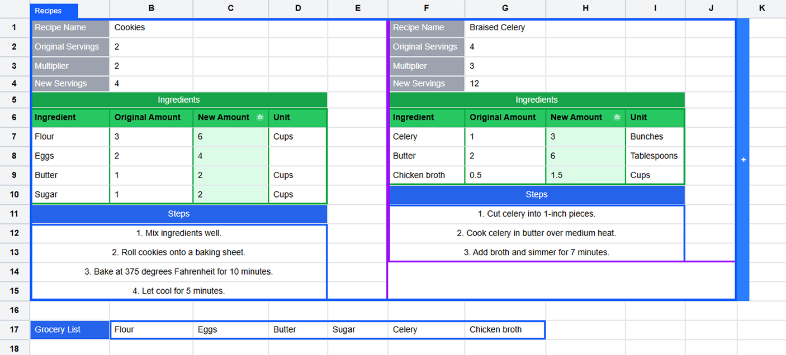
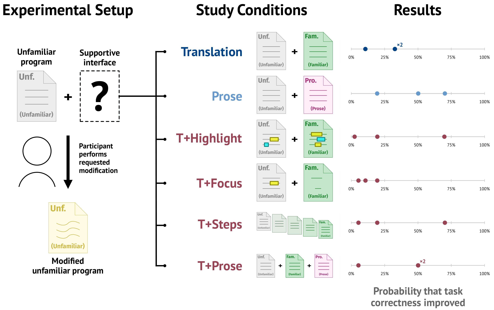
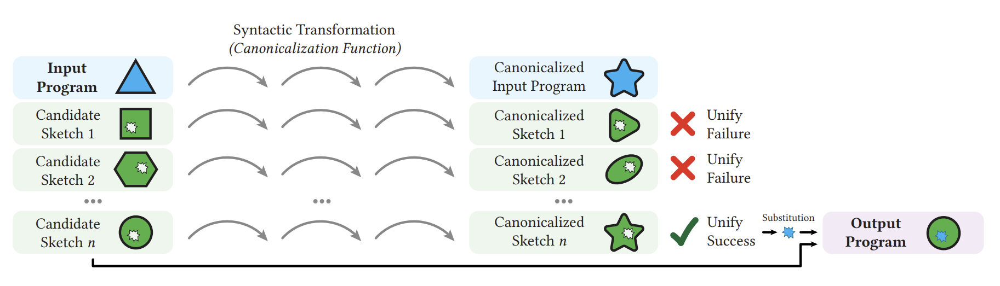
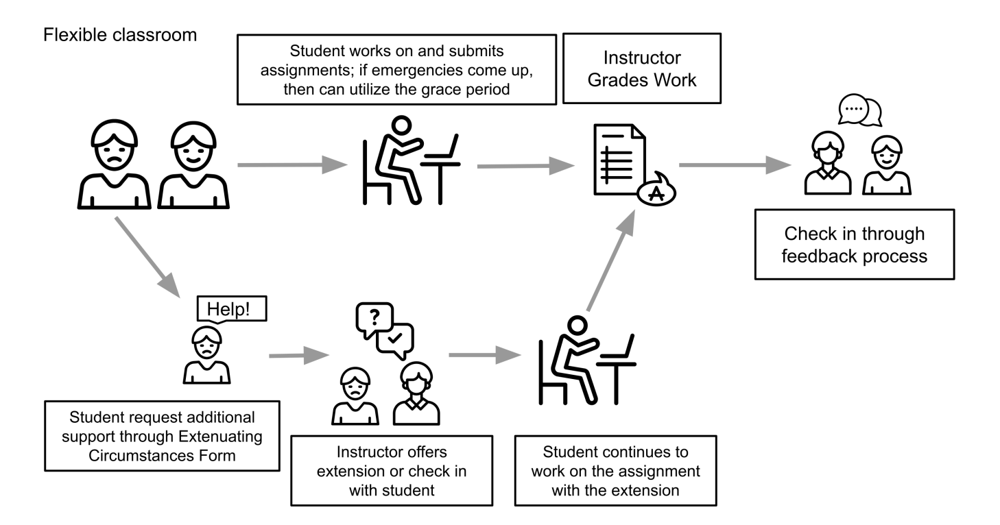

Hi! I am a 3rd year PhD student in Computer Science at UC San Diego, advised by [Michael Coblenz](https://cseweb.ucsd.edu/~mcoblenz/). I am part of the [Programming Systems Group](https://cseweb.ucsd.edu/groups/progsys/) and the [Design Lab](https://designlab.ucsd.edu/).

My research is in human-computer interaction, with a focus on end-user programming tools. Lately, I've been interested in enabling end users to manipulate the *structure* and *representation* of information across media. If you're also excited about these things, or if you're looking to get involved in research, I would love to hear from you!

In the past, I worked on program synthesis, CS education, and biology. I completed my undergraduate and master's degrees at UC Berkeley, where I worked with [Sarah E. Chasins](https://schasins.com/) and [Justin Lubin](https://jlubin.net/). I owe a lot to many amazing mentors, past and present!

## <button class="selected-toggle" onclick="this.textContent = document.body.classList.toggle('show-all') ? 'All' : 'Selected'">Selected</button> Publications

( * = equal contribution, † = research mentee)

  

  
  __Cellery: Gradual, Composable Structure for Spreadsheets__  
  [doi](https://doi.org/10.1145/3830398.3830625){: .btn} [pdf](assets/files/uist26_cellery.pdf){: .btn} [video (5 min)](https://youtu.be/8RdDz-4D09w)
  <ins>Jacob Yim</ins>, Sathwika Peechara†, Brian Hempel, and Michael Coblenz  
  *UIST 2026*
  

  

    
Abstract

    
Structure in spreadsheets is typically restricted to ranges of cells and flat tables. However, replacing the open-ended two-dimensional grid with a more structured alternative risks limiting users’ freedom and impeding exploratory workflows. How can we enable expressive structure in spreadsheets while preserving their flexibility? We propose a model that allows users to gradually add structure on top of the traditional grid. To identify common structural patterns, we conducted a content analysis of 30 real-world spreadsheets. Based on our findings, we developed Cellery, a novel spreadsheet system that makes these structures explicit. In Cellery, users gradually define the structure of their spreadsheets using named groupings of cells, composing together four structural primitives: Atoms, Lists, Tables, and Blocks. Once defined, users can directly manipulate structures, dynamically reference them in formulas, and incorporate them in reusable abstractions. We evaluate Cellery with an expressiveness study reproducing spreadsheets from our sample, demonstrating that it is capable of representing types of structure that traditional spreadsheets cannot. In a preliminary user study of five participants, we find that they successfully use Cellery to design spreadsheets with explicit structure, and we uncover opportunities for further work on the formula language.

  

  

  
  __Exploring the Translation-As-Explanation Folk Wisdom for Program Editing Tasks__  
  [pdf](assets/files/vlhcc26_translations.pdf){: .btn}  
  <ins>Jacob Yim</ins>\*, Justin Lubin\*, Kevin Ye, Laila Walker†, Eric Rawn, and Sarah E. Chasins  
  *VL/HCC 2026*
  

  

    
Abstract

    
Prior work in HCI and adjacent fields has often envisioned that a useful way to help programmers work with unfamiliar libraries or languages is to show a translation, an equivalent program written in a familiar library or language. However, prior work has not yet explored whether translations actually help programmers. Do they? Are there ways of presenting a given translation that make it more or less helpful? We conducted a 7-condition, 98-participant user study of program modification tasks, exploring whether a variety of translationcentric and non-translation interfaces helped participants. Surprisingly, there was a 67%–89% chance that translations alone made participants less likely to complete program modification tasks correctly. Our results lead us to question the intuition that translations are helpful for pragmatic purposes. More broadly, we highlight the need to better understand the practical knowledge required for program modification and adaptation—and how we can better design interventions that support these activities.

  

  

  
  __Equivalence by Canonicalization for Synthesis-Backed Refactoring__  
  [doi](https://doi.org/10.1145/3656453){: .btn} [pdf](assets/files/pldi24_cobbler.pdf){: .btn}  
  Justin Lubin, Jeremy Ferguson\*, Kevin Ye\*, <ins>Jacob Yim</ins>\*, and Sarah E. Chasins  
  *PLDI 2024*
  

  

    
Abstract

    
We present an enumerative program synthesis framework called component-based refactoring that can refactor “direct” style code that does not use library components into equivalent “combinator” style code that does use library components. This framework introduces a sound but incomplete technique to check the equivalence of direct code and combinator code called equivalence by canonicalization that does not rely on input-output examples or logical specifications. Moreover, our approach can repurpose existing compiler optimizations, leveraging decades of research from the programming languages community. We instantiated our new synthesis framework in two contexts: (i) higher-order functional combinators such as map and filter in the statically typed functional programming language Elm and (ii) high-performance numerical computing combinators provided by the NumPy library for Python. We implemented both instantiations in a tool called Cobbler and evaluated it on thousands of real programs to test the performance of the component-based refactoring framework in terms of execution time and output quality. Our work offers evidence that synthesis-backed refactoring can apply across a range of domains without specification beyond the input program.

  

  

  __Theme Work on Teamwork: Mapping Student Teaming Experiences in Design Projects__  
  [doi](https://doi.ieeecomputersociety.org/10.1109/FIE61694.2024.10892946){: .btn}  
  Sara Beckman, Krina Patel, Qiuquan Gu, Shang Zhu, Alexander Cui, and <ins>Jacob Yim</ins>  
  *FIE 2024*
  

  

    
Abstract

    
This innovative practice paper presents an analysis of data collected from the implementation of a teaming curriculum, Teaming by Design (TxD), across design and innovation courses. The study examines the successes and challenges identified by both undergraduate and graduate students in their teamwork experiences. The analysis draws on written reflections from 2,621 students enrolled in 47 design and innovation courses at the University of California, Berkeley. The identified themes from student reflections were compared with those derived from a comprehensive review of the teaming literature to pinpoint overlaps and gaps. Our findings reveal opportunities for refining project-based course structures and enhancing teaming pedagogy, with the goal of better equipping students with the essential teamwork skills they will need in their professional careers.

  

  

  
  __Supporting Mastery Learning with Flexible Extensions__  
  [doi](https://doi.org/10.1145/3626253.3635615){: .btn}  
  Yuerou Tang\*, <ins>Jacob Yim</ins>\*, Jordan Schwartz, Madison Bohannan, Dana Benedicto, Charisse Liu, Armando Fox, Lisa Yan, and Narges Norouzi  
  *SIGCSE TS 2024 Poster*
  

  

    
Abstract

    
Equitable grading practices and flexible deadline policies have previously demonstrated positive student learning and well-being outcomes. In this poster, we contribute a framework for flexible extension policies that emphasize equitable grading. We then analyze extension requests and grades obtained by students in a Data Science course with a flexible extension policy. We present two research questions based on this data. RQ1: How does the length of an extension relate to student performance on the corresponding assignment? RQ2: How does student extension usage across the semester relate to students' learning of the content?

  

  

  __Automated Support for Flexible Extensions__  
  [doi](https://doi.org/10.1145/3626253.3635628){: .btn}  
  Jordan Schwartz, Madison Bohannan, <ins>Jacob Yim</ins>, Yuerou Tang, Dana Benedicto, Charisse Liu, Armando Fox, Lisa Yan, and Narges Norouzi  
  *SIGCSE TS 2024 Poster*
  

  

    
Abstract

    
In this work, we present the development of an automated extension tool that supports flexible extension policies. Students interact with a wide range of extension policies in similar ways; in particular, some students repeatedly request multi-day long extensions. When scaled to courses with hundreds or potentially thousands of students, course staff time is the limiting resource preventing adequate student support. We present a tool to help automate a range of extension processes. The use of this tool should reduce staff load while increasing individualized student support, through email communication and consequent recovery of student agency. Our early research questions are: Does the extension tool reduce barriers and stigma around asking for assistance? Does the tool lessen the wait time between requesting and receiving an extension, and how does the tool improve students' learning experience in the course? These questions will help inform us about how an automated tool for flexible extensions helps support growing course sizes and students who may not otherwise receive the support they need for their success and well-being in the course.

  

  

  __Searching for Incidental Specifications__  
  [doi](https://doi.org/10.1184/R1/22277332.v1){: .btn}  
  Jeremy Ferguson\*, Kevin Ye\*, <ins>Jacob Yim</ins>\*, and Justin Lubin  
  *PLATEAU 2023*
  

  

    
Abstract

    
Program synthesizers—tools that automatically generate code based on a user-provided specification—aim to lighten the burden of programming by ideally swapping the cost of manually performing a task or writing code for a task with the cost of writing a specification for that task. A concern of fundamental importance to the usability of these synthesizers is therefore to ensure that the specification cost is less than the manual cost. In this short paper, we discuss methods from human-computer interaction, techniques from software engineering and data mining, and theories from cognitive science that could directly help answer the question of what tasks are amenable to having specifications derived from users’ existing behaviors and processes rather than having users go out of their way to provide something new to the synthesizer—thereby ensuring the cost of specification is appropriately lower. We hope that this discussion is useful for synthesis designers and sparks interest in further investigation into how we can derive specifications from users’ existing behaviors and processes.

  

  

  __Reprogramming of DNA methylation at NEUROD2-bound sequences during cortical neuron differentiation__  
  [doi](https://doi.org/10.1126/sciadv.aax0080){: .btn}  
  Maria A Hahn, Seung-Gi Jin, Arthur X Li, Jiancheng Liu, Zhijun Huang, Xiwei Wu, Byung-Wook Kim, Jennifer Johnson, Adrienne-Denise V Bilbao, Shu Tao, <ins>Jacob A Yim</ins>, Yuman Fong, Sandra Goebbels, Markus H Schwab, Qiang Lu, and Gerd P Pfeifer  
  *Science Advances*
  

  

    
Abstract

    
The characteristics of DNA methylation changes that occur during neurogenesis in vivo remain unknown. We used whole-genome bisulfite sequencing to quantitate DNA cytosine modifications in differentiating neurons and their progenitors isolated from mouse brain at the peak of embryonic neurogenesis. Localized DNA hypomethylation was much more common than hypermethylation and often occurred at putative enhancers within genes that were upregulated in neurons and encoded proteins crucial for neuronal differentiation. The hypomethylated regions strongly overlapped with mapped binding sites of the key neuronal transcription factor NEUROD2. The 5-methylcytosine oxidase ten-eleven translocation 2 (TET2) interacted with NEUROD2, and its reaction product 5-hydroxymethylcytosine accumulated at the demethylated regions. NEUROD2-targeted differentially methylated regions retained higher methylation levels in Neurod2 knockout mice, and inducible expression of NEUROD2 caused TET2-associated demethylation at its in vivo binding sites. The data suggest that the reorganization of DNA methylation in developing neurons involves NEUROD2 and TET2-mediated DNA demethylation.

  

## Teaching
[__CSE 170: Interaction Design__](https://kristenvaccaro.github.io/interaction-design/) @ UCSD  
teaching assistant: Fall 2026

[__CSE 210: Principles of Software Engineering__](https://mcoblenz.github.io/CSE210/) @ UCSD  
teaching assistant: Winter 2026

[__DSC 106: Data Visualization__](https://dsc106.com) @ UCSD  
head teaching assistant: Fall 2025

[__Data 100: Principles and Techniques of Data Science__](https://ds100.org) @ UC Berkeley  
lead teaching assistant: Summer 2024  
teaching assistant: Spring 2023, Fall 2022, Summer 2022  
course tutor: Spring 2022, Fall 2021

last updated: 11/1/26 🍂

<!-- Photo credit to Sami Chiang. The font is Redaction. -->